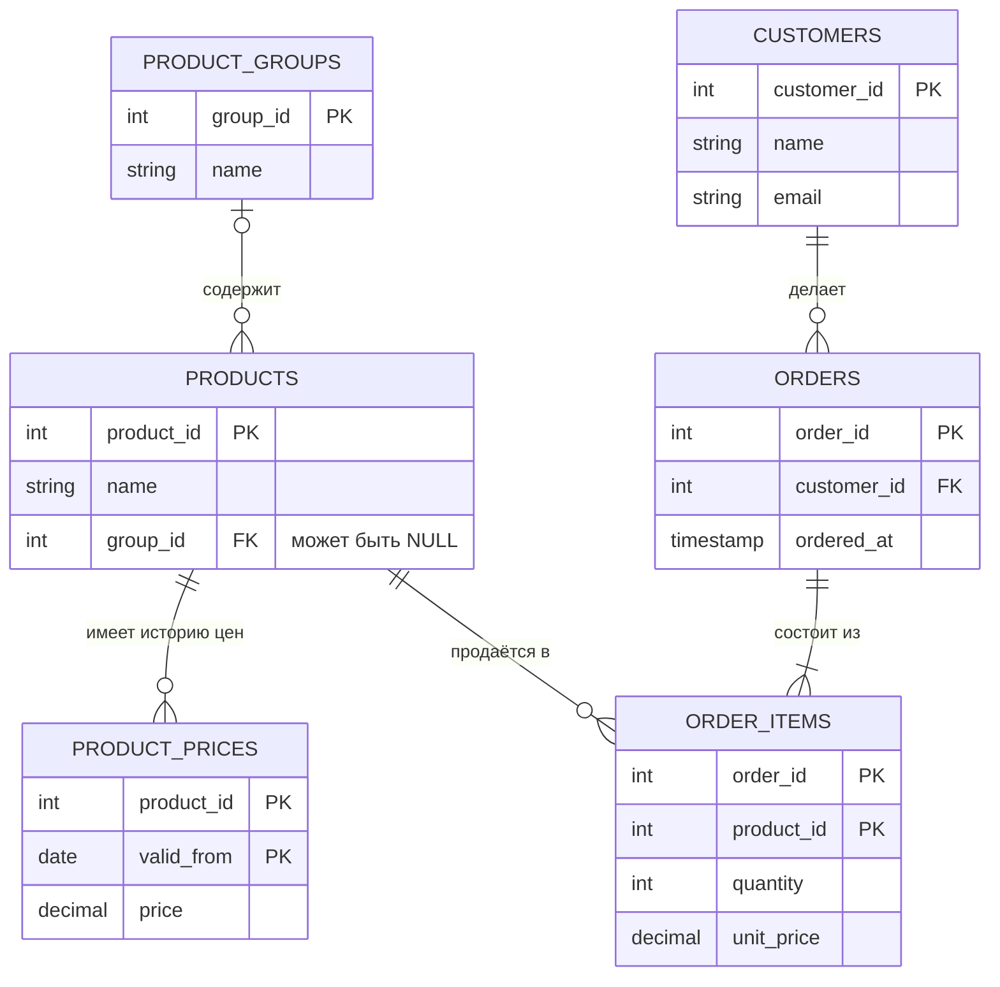

# Схема БД онлайн-магазина

## Ключевые решения

- **Не все товары состоят в группе:** `products.group_id` может быть `NULL`; в отчёте такие товары идут как «Без группы» (`LEFT JOIN` + `COALESCE`).
- **Цена меняется со временем:** история цен хранится в `product_prices`, а в `order_items.unit_price` фиксируется цена на момент продажи. Поэтому отчёт за прошлые месяцы не меняется после смены цены.
- **Одна позиция заказа = один товар в заказе:** составной ключ (`order_id`, `product_id`); количество в `quantity`.
